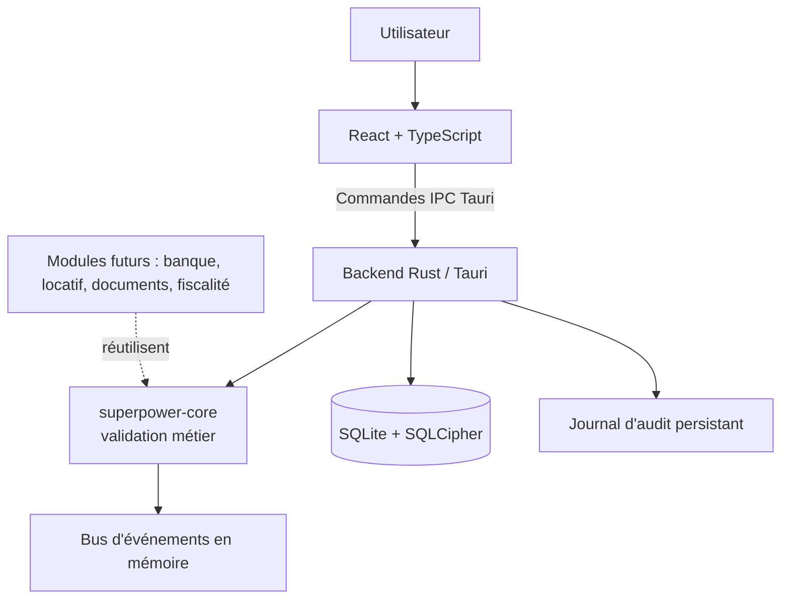

# Architecture technique — SuperPower Alpha

## 1. Principes

- Application desktop locale : Rust + Tauri 2, avec une interface React + TypeScript.
- Persistance mono-poste par défaut : base SQLite chiffrée via SQLCipher.
- Domaines fiscaux et métiers séparés ; aucune règle fiscale implicite déduite uniquement du nom d'une société.
- Frontière IPC explicite entre le frontend et les commandes Rust.
- Noyau testable sans UI, sans SQLite et sans Tauri.
- Pas de LLM local ni d'appel réseau requis pour l'interface ou le fonctionnement métier courant.

## 2. Vue de contexte



## 3. Structure réellement livrée

```text
SuperPower-Alpha-0.1/
├── README.md                 # Entrée GitHub : présentation, démarrage, sécurité
├── AGENTS.md                 # Consignes courtes pour une IA/un développeur qui reprend le code
├── Cargo.toml                # Workspace : crates/core + src-tauri
├── crates/
│   └── core/src/
│       ├── lib.rs            # Ré-exports
│       ├── accounting.rs     # Account, EntryLine, validate_entry_lines, starter_accounts (26 comptes)
│       ├── society.rs        # Societe, enums de régimes, validation, avertissements
│       └── events.rs         # EventBus mpsc en mémoire (non branché pour l'instant)
├── src-tauri/
│   ├── Cargo.toml / build.rs / tauri.conf.json / capabilities/default.json
│   └── src/
│       ├── main.rs
│       ├── lib.rs            # Enregistrement des 10 commandes IPC
│       ├── database.rs       # AppState, SQLCipher, Argon2id, schéma v1
│       └── commands.rs       # Commandes IPC + requêtes SQL
├── frontend/
│   ├── index.html / vite.config.ts / tsconfig.json
│   └── src/
│       ├── main.tsx
│       ├── App.tsx           # Toute l'UI (≈370 lignes) : à découper
│       ├── lib/api.ts        # Adaptateur Tauri + aperçu volatile navigateur
│       ├── lib/types.ts      # Types miroirs des structures Rust (camelCase)
│       ├── lib/money.ts(+test) # Montants exacts en centimes
│       └── styles/app.css    # Design system et cinq thèmes
├── scripts/check_docs.py     # Contrôle des Markdown, liens locaux, JSON de config
├── docs/                     # Documentation (index : docs/README.md ; reprise : docs/HANDOFF.md)
└── .github/workflows/ci.yml
```

Les autres modules (import bancaire, tâches durables, gestion locative, OCR documentaire, trésorerie et fiscalité déclarative) sont planifiés mais ne doivent pas être considérés comme présents parce que leurs pages apparaissent dans la navigation.

## 4. Modèle métier de la première brique

### Société

La fiche enregistre séparément :

- forme juridique : SCI, SARL, SAS ou autre ;
- régime d'imposition du résultat : IR, IS ou non renseigné ;
- régime TVA : non renseigné, hors champ, franchise en base, réel simplifié ou réel normal ;
- exigibilité TVA : non définie, non applicable, encaissements ou débits ;
- périodicité déclarative : non définie, non applicable, mensuelle, trimestrielle ou annuelle ;
- SIRET facultatif et date de clôture comptable.

La liste de valeurs est une base de paramétrage, pas une décision juridique. Pour les locations immobilières, le traitement TVA peut dépendre de la nature du local, de l'opération, d'une option valable, du bail et de la situation du preneur. Le sprint de gestion locative devra donc ajouter les paramètres nécessaires au niveau du bien/lot et du bail, sans supposer qu'une seule propriété « TVA de la société » suffise à tous les cas.

### Comptabilité

- Les montants sont des centimes signés/positifs selon le côté débit ou crédit (`i64`).
- Une ligne ne peut pas avoir en même temps un débit et un crédit.
- Les écritures doivent comporter au moins deux lignes, un total non nul et un total débit égal au total crédit.
- Le backend vérifie que la société et les comptes existent avant d'insérer l'écriture.
- Les écritures sauvegardées sont au statut `validated` et aucun endpoint de modification/suppression n'est exposé dans cette alpha. **Attention : l'immutabilité n'est aujourd'hui garantie que par l'absence d'endpoint** ; la base elle-même accepte un `UPDATE`/`DELETE` direct (constaté lors du test du schéma, 2026-10-12). Des triggers SQL d'interdiction sont à ajouter (voir HANDOFF).
- Le plan de comptes livré est un **socle illustratif limité**, et non le PCG exhaustif certifié. Les comptes et leur paramétrage devront être revus et versionnés avant utilisation comptable en production.

## 5. Persistance et chiffrement

### Première ouverture

1. L'application demande une phrase secrète d'au moins 12 caractères.
2. Un sel aléatoire de 16 octets est conservé dans `superpower.salt` à côté de `superpower.db`.
3. Argon2id dérive une clé de 256 bits en mémoire ; la clé est fournie à SQLCipher.
4. La phrase secrète n'est pas sauvegardée par l'application. Elle est à conserver dans un gestionnaire de mots de passe.

À chaque lancement ultérieur, la base est verrouillée jusqu'à ressaisie de la phrase secrète. Le fichier de sel n'est pas secret, mais il est indispensable : une sauvegarde doit contenir **la base et son fichier `.salt`**. Si la phrase secrète est perdue, les données sont irrécupérables.

Le moteur de compilation doit inclure la fonctionnalité SQLCipher `bundled-sqlcipher-vendored-openssl`. En cas de problème de compilation de cette dépendance, ne pas rétrograder à SQLite non chiffré. Cette configuration doit être confirmée par un build et un test natifs sur Windows avant usage réel.

### Journal d'audit

Un journal d'audit de premier niveau (append-only par convention applicative, **pas encore par contrainte SQL**) enregistre la création des sociétés et la validation des écritures. Le système de journalisation n'est pas encore exhaustif : les corrections, sauvegardes, déverrouillages, migrations, exports et accès doivent y être ajoutés avant la production.

## 6. Frontend et mode de démonstration

Le mode navigateur existe pour prévisualiser les écrans et tester les interactions. Il maintient uniquement un état mémoire JavaScript, perdu au rechargement ; les données ne sont pas chiffrées et ce mode n'est pas adapté aux données réelles. Le mode natif utilise les commandes Tauri et la base SQLCipher.

Les cinq thèmes sont stockés dans `localStorage` parce que cette préférence visuelle ne contient pas de données métier. Les polices utilisent la pile système ; aucun chargement de police distant n'est nécessaire.

## 7. Sécurité à compléter

Avant la production :

- triggers SQL interdisant `UPDATE`/`DELETE` sur `ecritures`, `lignes_ecriture` et `journal_audit` ;
- effacement mémoire de la clé dérivée (aujourd'hui `String` hexadécimale conservée dans `AppState`, non zéroïsée) ;
- tests natifs réels de l'absence de données SQLite en clair et du rejet d'une mauvaise phrase secrète ;
- sauvegarde et restauration chiffrées, contrôle d'intégrité et procédure de migration ;
- audit complet avec transaction atomique pour chaque mutation sensible ;
- contre-passations, clôtures d'exercice et verrouillage des périodes ;
- validation FEC avec jeux d'essai ;
- tests de fuzzing/imports, durcissement CSP et audit des dépendances ;
- stratégie de récupération expliquée clairement à l'utilisateur.

## 8. Contrat IPC actuel (frontend ↔ Rust)

Champs JSON en `camelCase`, valeurs d'énumérations en `snake_case`. Les erreurs sont des `String` en français affichables telles quelles.

| Commande | Arguments | Retour |
|---|---|---|
| `database_status` | — | `needs_setup` \| `locked` \| `ready` |
| `initialize_database` | `passphrase` (≥ 12 caractères) | — |
| `unlock_database` | `passphrase` | — |
| `lock_database` | — | — |
| `list_societes` | — | `Societe[]` + `warnings` |
| `create_societe` | `input: CreateSocieteInput` | `Societe` |
| `list_comptes` | — | `Account[]` |
| `create_ecriture` | `input: CreateEntryInput` | `EntryView` |
| `list_ecritures` | `societeId?` (limite 500) | `EntryView[]` |
| `dashboard_summary` | — | compteurs + volume en centimes |

Toute nouvelle commande doit être ajoutée à la fois dans `commands.rs`, dans `generate_handler!` (`lib.rs`), dans `frontend/src/lib/types.ts` et, si elle doit marcher dans l'aperçu navigateur, dans `browserCommand` de `api.ts`.

## 9. Schéma SQLite v1 (`PRAGMA user_version = 1`)

`societes` · `accounts` (`is_seed`) · `ecritures` (`statut` limité à `validated`, `total_cents > 0`) · `lignes_ecriture` (`UNIQUE(ecriture_id, ordre)`, `CHECK` anti-débit+crédit simultanés, FK vers `accounts` et `ecritures`) · `journal_audit`. Les plans de comptes sont **globaux** (non filtrés par société) ; il n'existe pas encore de table `exercices` ni `journaux`. Le schéma est créé en une fois par `create_schema` : il n'y a pas encore de mécanisme de migration versionnée.

## 10. Évolutions modulaires

Ordre recommandé : noyau et journaux, moteur de tâches persistant, import bancaire et rapprochement, référentiel documentaire, biens/baux/loyers, trésorerie, fiscalité préparatoire, synchronisation mobile, puis stocks si le besoin métier le justifie. Le moteur de tâches devra être choisi et testé avant d'adopter une dépendance tierce telle que `flexiq-core`.
